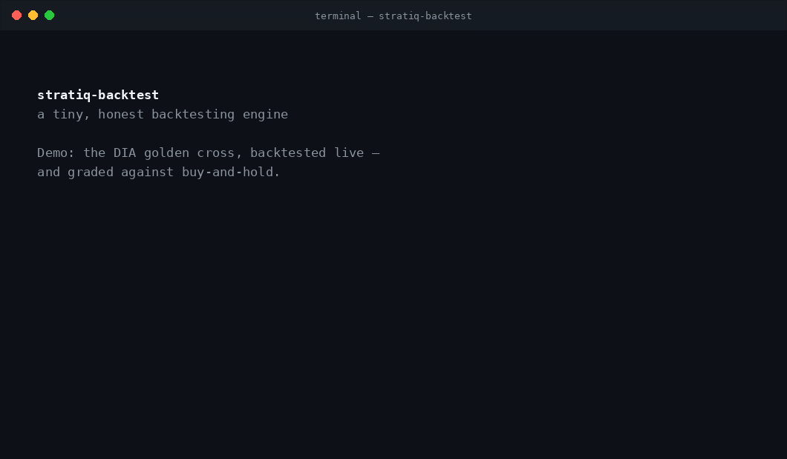

# stratiq-backtest

A tiny, honest backtesting engine. Long-only signal backtests with full trade logs — and every result shown next to the do-nothing alternative, because a strategy that beats nothing is a hobby.

This is the engine behind [StratIQ's public track record](https://stratiqai.app/track-record), where every backtest is published with wins and losses.



_The demo runs [`examples/golden_cross_dia.py`](examples/golden_cross_dia.py) on real DIA data — the worked example below, with the receipts._

## Install

```bash
pip install stratiq-backtest
```

Or from source: `pip install .` — zero dependencies, stdlib only.

## Quickstart

```python
from stratiq_backtest import CrossoverStrategy, run, summarize, synthetic_bars

data = synthetic_bars(n=1500, seed=42)   # reproducible demo data (NOT real market data)
strat = CrossoverStrategy(fast=50, slow=200)   # golden cross
result = run(data, strat, warmup=strat.warmup)
stats = summarize(data, result)

print(stats["strategy_total_return_pct"], "vs buy-and-hold",
      stats["buyhold_total_return_pct"])
for t in stats["trades"]:
    print(t)
```

Run the bundled example (golden cross on synthetic data):

```bash
python3 examples/golden_cross_synthetic.py
```

## A real example, with real output

Golden cross (50/200 SMA) on DIA, Yahoo Finance dividend/split-adjusted
daily closes, 2019-01-02 → 2026-11-06 (test window starts 2019-10-16,
after the 200-day warmup):

```python
from stratiq_backtest import CrossoverStrategy, run, summarize, fetch_yahoo

data = fetch_yahoo("DIA", end="2026-11-06")
strat = CrossoverStrategy(fast=50, slow=200)
stats = summarize(data, run(data, strat, warmup=strat.warmup))
```

| | Golden cross | Buy-and-hold |
|---|---|---|
| Total return | +81.0% | +115.2% |
| CAGR | 8.8% | 11.5% |
| Max drawdown | −16.0% | −36.7% |

3 trades, all winners (win rate 100.0%, average win +21.98%), 75.0% of
the time in the market. $10,000 became $18,100 following the rule vs
$21,520 holding. The rule never lost a trade in seven years — and still
finished 34 points behind, because it sat out a quarter of a long bull
market. That is the honest shape of this signal, and it is why every
result this engine returns carries buy-and-hold next to it.

Full trade log:

1. 2020-07-30 @ 236.18 → 2022-03-11 @ 304.51 — +28.93%
2. 2022-12-12 @ 319.02 → 2025-04-22 @ 383.22 — +20.12%
3. 2025-07-10 @ 438.22 → 2026-11-06 @ 512.22 — +16.89% (still open at the final close, marked at that close)

Cross-check: this is StratIQ's published backtest of the same rule —
https://stratiqai.app/published-backtests/golden-cross-dia — and the
numbers above reproduce it exactly. No commissions, slippage, or taxes
are modeled (see "Execution semantics"); 3 round trips of real costs
would trim the result slightly.

Prefer not to install anything? The same engine runs behind a web form:
[Test-My-Rule](https://stratiqai.app/test-my-rule?src=hn) — name a rule, get the receipts vs buy-and-hold.

## Execution semantics (read this before trusting a number)

- **Trades print at the close of the bar that generates the signal.** The strategy sees bar *i*'s close; the trade executes at bar *i*'s close.
- **No look-ahead, ever.** A position entered on bar *i* does **not** earn bar *i*'s return — that move already happened before the trade printed. It starts earning on bar *i+1*. A position exited on bar *i* **does** earn bar *i*'s return (it was exposed during the bar, sold at its close).
- Long-only, fully invested-or-cash. No leverage, no shorting. No commissions, no slippage, no taxes — real trading will do worse by roughly those costs.
- Use dividend/split-adjusted closes or your returns will be wrong.

> **Correction note (v0.2.0):** v0.1.0 credited each new position with the signal bar's own price move. That is look-ahead bias — the signal only exists after the bar closes — so v0.1.0 results were biased and unreliable, and must be re-run. (Note: "biased" does not always mean "overstated" — the old loop also dropped exit-bar returns, so on some datasets the corrected run comes out higher.) v0.2.0 fixes the execution timing and adds regression tests pinning the corrected behavior. If you published numbers computed with v0.1.0, re-run them.

## Data

The repo ships **no real market data**. `synthetic_bars()` generates a deterministic seeded random walk for examples and tests — reproducible forever, and clearly labeled synthetic. Never publish performance numbers computed on it as if they were real.

For real data:
- `fetch_yahoo(symbol)` — free daily bars from Yahoo Finance's chart API, adjusted close (dividend- and split-adjusted). Unofficial endpoint; fails loudly.
- `fetch_stooq(symbol)` — free daily bars from Stooq, no API key. **Split-adjusted but NOT dividend-adjusted**: fine for experimenting, not for publishing numbers. (As of 2026-11 Stooq serves a JavaScript browser check to plain HTTP clients, so this path currently fails live; `fetch_yahoo` is the working one.)
- `load_json()` / `load_csv()` — bring your own dividend/split-adjusted closes.

## Use it inside your AI assistant (MCP)

The engine ships an [MCP](https://modelcontextprotocol.io) server, so Claude, Claude Code, Cursor, and other MCP clients can backtest inside the conversation — every result arrives with buy-and-hold next to it, the full trade log, the data caveats, and a link to test your own rule.

```bash
python3 -m stratiq_backtest.mcp_server
```

MCP client config (stdio):

```json
{
  "mcpServers": {
    "stratiq-backtest": {
      "command": "stratiq-backtest-mcp"
    }
  }
}
```

Tools:

- `backtest_crossover` — `{ticker, fast=50, slow=200, start="2019-01-01"}`. Real daily bars via Yahoo Finance's adjusted-close series (dividend- and split-adjusted — the result carries its data caveats in the result).
- `stratiq_track_record` — StratIQ's live graded record, fetched from stratiqai.app at call time. If the feed is unreachable it returns the page link and **no numbers** — a stale record is worse than none.

## Write your own strategy

```python
from stratiq_backtest import Strategy

class MyStrategy(Strategy):
    def on_bar(self, i, data, position):
        # i: current bar index, data.closes / data.dates available.
        # Return 1 to be long, 0 for cash. The new position takes
        # effect AFTER bar i's close (see execution semantics above).
        ...
```

Warm up indicators with `warmup=` so signals only fire on fully-formed values.

## Tests

```bash
python3 -m pytest tests/
```

Happy paths, failure modes, edge cases — including regression tests that pin the no-look-ahead contract above.
